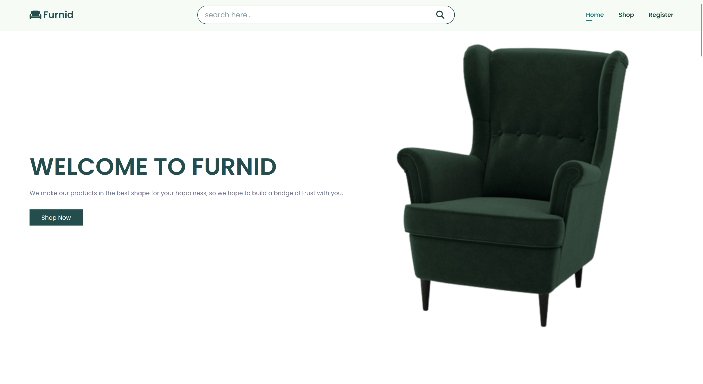
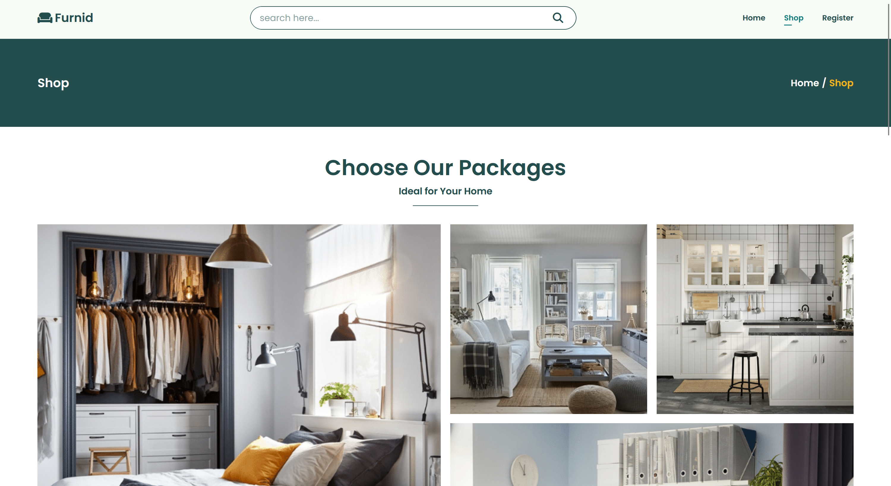
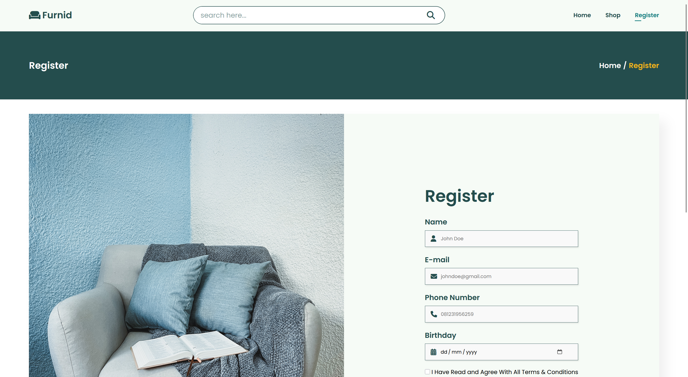

# Furnid - Furniture Store Website

## Overview

Furnid is a static, multi-page furniture catalog website. It showcases furniture collections and a registration form through an HTML and CSS interface.

## Features

- **Home:** Featured furniture, new products, brand information, and promotional banners.
- **Shop:** Furniture packages, product categories, and a product catalog.
- **Register:** A form layout for visitor details and terms acceptance.

## Tech Stack

- HTML5
- CSS3
- Font Awesome icons loaded from an external CDN

The project has no local JavaScript, backend, dependencies, or build step.

## Project Structure

```text
Furnid/
├── index.html
├── shop.html
├── register.html
├── logo.svg
├── css/
│   ├── base.css
│   ├── home.css
│   ├── shop.css
│   └── register.css
├── assets/
│   ├── footer/payment/
│   ├── form/album/
│   ├── home/
│   │   ├── banner/
│   │   ├── new-products/
│   │   ├── photo-furniture/
│   │   └── products/
│   ├── images/preview/
│   └── shop/
│       ├── icon/
│       ├── photo-furniture/
│       └── products/
└── docs/superpowers/
    ├── plans/
    └── specs/
```

Shared styles are in `css/base.css`; each page's additional styles are in its corresponding stylesheet. Images and other static media are organized under `assets/`.

## Getting Started

1. Clone or download this repository.
2. Open `index.html` directly in a browser.

No installation or build command is required. A local static server, such as the VS Code Live Server extension, can also be used. An internet connection is needed to load Font Awesome icons from its CDN.

## Limitations

This project is a frontend demonstration, not a complete ecommerce service. Product search, cart and favorite controls are not connected to application logic. The registration form has no backend and does not store submissions.

## Preview

### Home



### Shop



### Register


